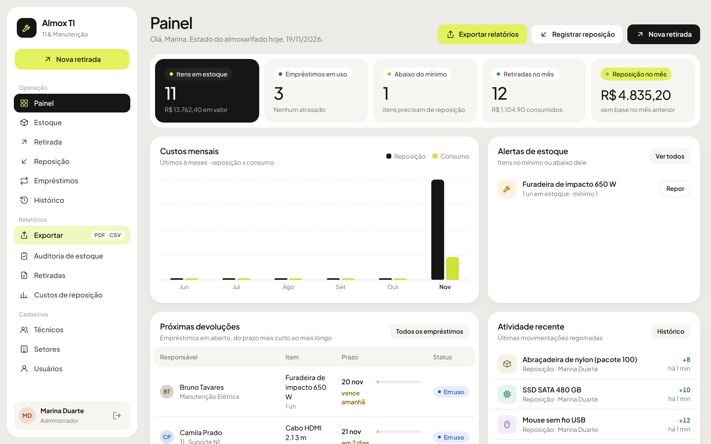
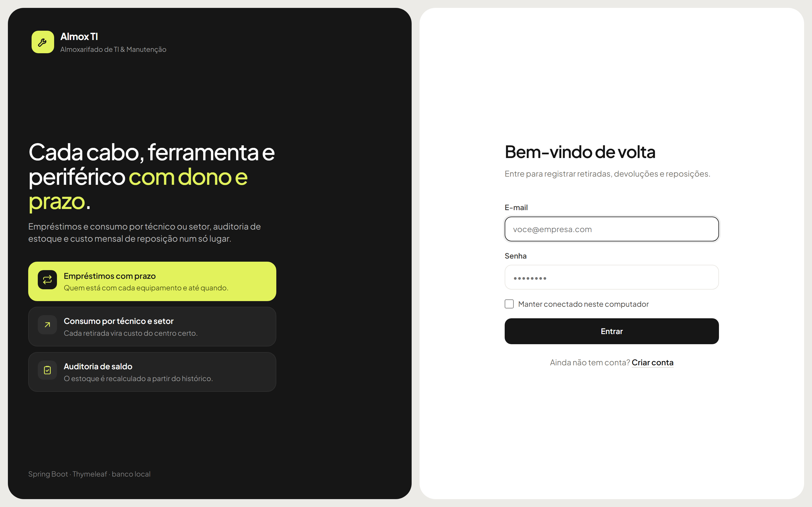
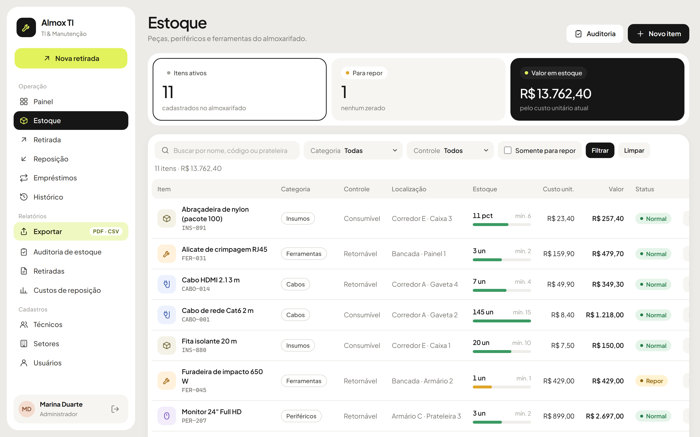
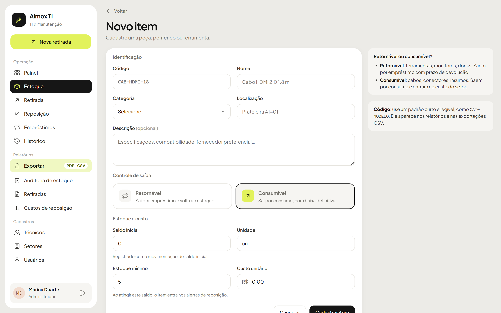
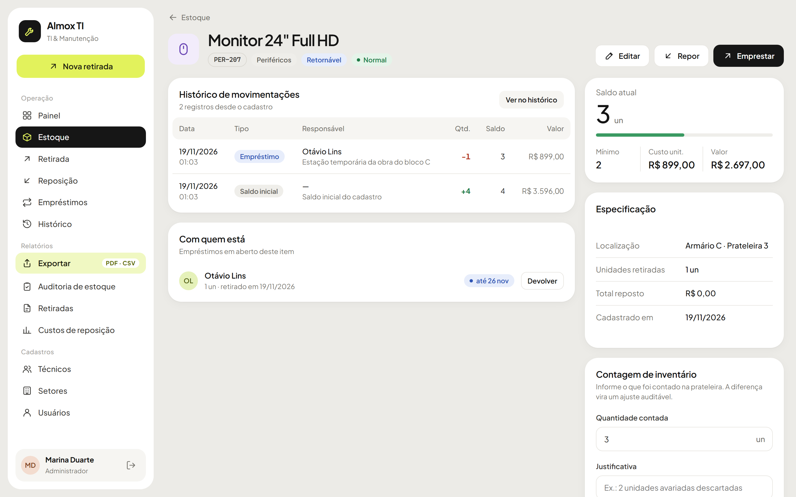
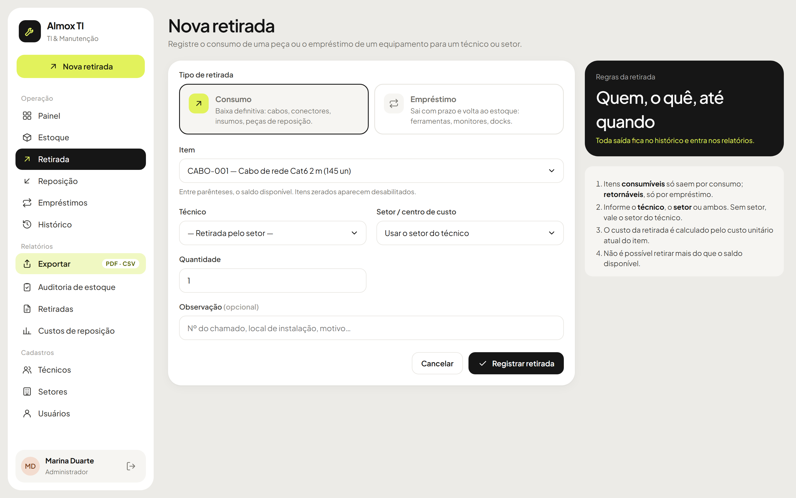
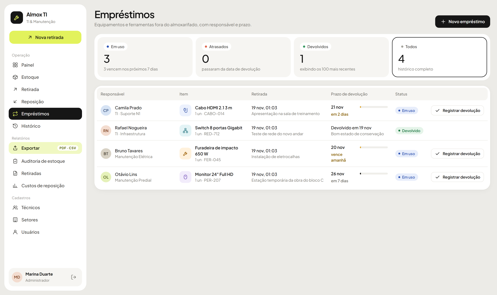
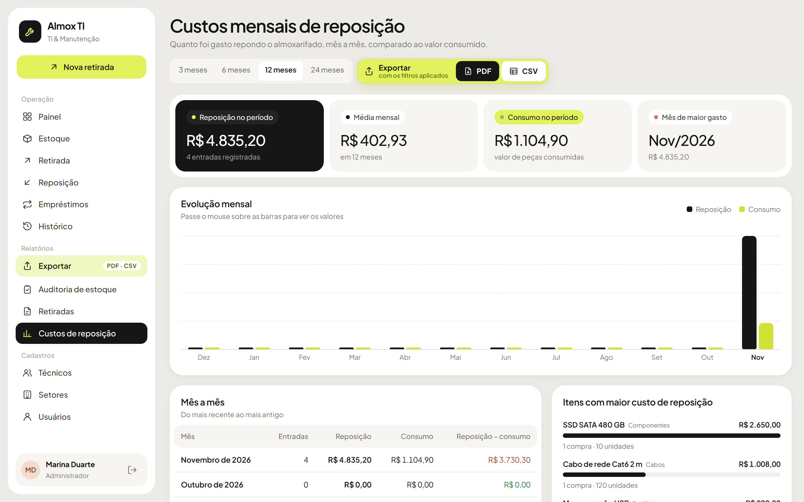
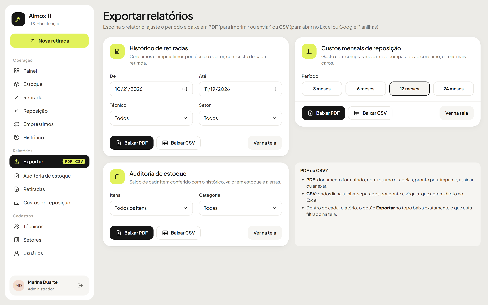
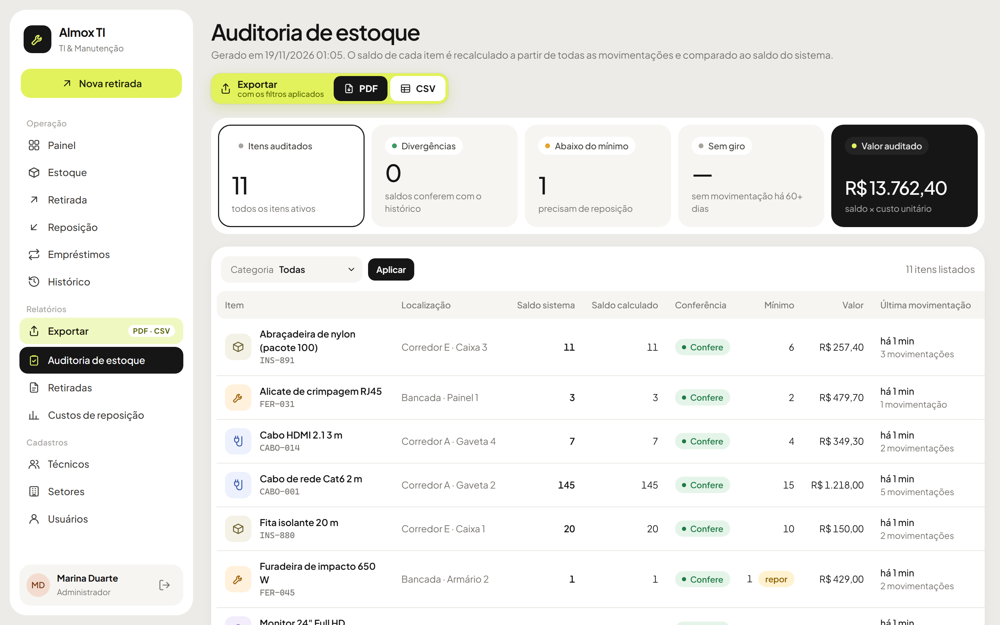

# Almox TI: almoxarifado de TI e Manutenção

Sistema web para controlar o **empréstimo** e o **consumo** de cabos, periféricos, ferramentas, componentes e
insumos por **técnico** ou **setor**, com **auditoria de estoque**, **histórico de retiradas** e **custos mensais
de reposição** exportáveis em PDF e CSV.



## Sobre o projeto

O Almox TI nasceu como atividade da disciplina de **Programação Web**, cujo enunciado pedia o
"**cadastro de produtos e lista de produtos**". Aqui os produtos são os **itens do estoque**, e o requisito aparece
em duas telas:

| Pedido do enunciado | No Almox TI | Rota |
| --- | --- | --- |
| Cadastro de produtos | **Cadastro de item do estoque** (código, nome, categoria, controle, unidade, saldo inicial, mínimo, custo e localização) | `/itens/novo` |
| Lista de produtos | **Estoque**: lista com busca, filtros por categoria, controle e situação, além dos totais de saldo e valor | `/itens` |

Sobre essa base, o sistema foi levado adiante até virar uma ferramenta de almoxarifado de verdade: cada item tem
saldo controlado por movimentações, cada saída tem responsável e prazo, e os relatórios reconstroem o que entrou,
saiu e quanto custou repor.

## Funcionalidades

| Área | O que faz |
| --- | --- |
| **Painel** | Indicadores do dia (itens, valor em estoque, empréstimos em uso, abaixo do mínimo, retiradas e reposições do mês), gráfico de custos dos últimos 6 meses, alertas de estoque mínimo, próximas devoluções e atividade recente. |
| **Estoque** | Cadastro de itens com código, categoria, controle (retornável/consumível), localização, estoque mínimo e custo. Busca e filtros por categoria, controle e situação. Detalhe com histórico, empréstimos em aberto e contagem de inventário. |
| **Retirada** | Saída por **consumo** (baixa definitiva) ou **empréstimo** (com prazo de devolução), para um técnico, um setor ou ambos. Valida saldo disponível e o tipo do item. |
| **Reposição** | Entrada de compras com quantidade, custo unitário pago e observação (NF). Atualiza o custo do item. |
| **Empréstimos** | Em uso, atrasados, devolvidos e todos, com barra de prazo, dias restantes e registro de devolução com condição do equipamento. |
| **Histórico** | Todas as movimentações, com filtros por período, tipo, técnico, setor e texto livre. |
| **Auditoria de estoque** | Recalcula o saldo de cada item a partir das movimentações e compara com o saldo gravado, apontando divergências, itens sem giro e ajustes de inventário. |
| **Relatório de retiradas** | Totais e rankings por técnico, setor e item, com detalhamento por período. |
| **Custos de reposição** | Série mês a mês (3, 6, 12 ou 24 meses), itens e categorias mais caros e consumo por setor para rateio. |
| **Exportação** | Central `/relatorios/exportar` e botões **PDF · CSV** dentro de cada relatório, sempre com os filtros da tela aplicados. |
| **Cadastros** | Técnicos (com ativação/desativação), setores com centro de custo e usuários de acesso. |

## Telas

Todas as capturas foram tiradas do próprio sistema, com dados cadastrados pela interface numa base de demonstração.

### Login



Entrada com e-mail e senha. A primeira conta criada no sistema vira administradora.

### Estoque: a lista de produtos



A lista de produtos: busca por nome, código ou prateleira, filtros por categoria e controle, saldo contra o mínimo e valor em estoque.

### Cadastro de item: o cadastro de produtos



O cadastro de produtos: código, nome, categoria, controle de saída, saldo inicial, estoque mínimo, custo e localização.

### Detalhe do item



Saldo, custo, quem está com o item e o histórico de movimentações que explica cada número.

### Retirada



Consumo ou empréstimo para um técnico, um setor ou os dois, com as regras da saída lado a lado.

### Empréstimos



Prazo de cada equipamento em uso, atrasos, devoluções e o registro da condição na volta.

### Custos de reposição



Custos de reposição mês a mês, itens e categorias mais caros e consumo por setor para rateio.

### Exportar relatórios



A central de exportação: escolha o relatório, ajuste o período e baixe em PDF ou CSV.

### Auditoria de estoque



O saldo do sistema conferido contra a soma das movimentações, item por item.

## Baixar e rodar

Precisa de **Java 21** (ou mais novo). Há três caminhos.

### 1. Arquivo executável (o mais simples)

1. Baixe o `almox-ti.jar` em <https://github.com/twkryan/spring-boot-almoxarifado/releases/latest>.
2. Coloque em uma pasta vazia e rode:

   ```bash
   java -jar almox-ti.jar
   ```

3. Acesse <http://localhost:8080>.

### 2. Docker

```bash
git clone https://github.com/twkryan/spring-boot-almoxarifado.git
cd spring-boot-almoxarifado
docker build -t almox-ti .
docker run -p 8080:8080 -v almox-dados:/app/data almox-ti
```

O volume `almox-dados` guarda o banco entre execuções.

### 3. Código-fonte

```bash
git clone https://github.com/twkryan/spring-boot-almoxarifado.git
cd spring-boot-almoxarifado
```

No Windows, dê dois cliques em **`iniciar.bat`**; no Linux/macOS, rode **`./iniciar.sh`**. Os dois scripts conferem a
versão do Java, usam o `almox-ti.jar` se ele estiver na pasta e, se não estiver, compilam pelo Maven Wrapper. Para
rodar direto pelo Maven: `./mvnw spring-boot:run`.

Depois de subir por qualquer caminho, abra <http://localhost:8080> e clique em **Criar conta**. A **primeira conta
criada vira administradora**; as seguintes entram como operadoras.

> O passo a passo completo (Java, firewall, banco, backup, Docker, problemas comuns) está em
> [docs/INSTALACAO.md](docs/INSTALACAO.md).

## Primeiro uso

Numa instalação nova o banco começa vazio — não há carga de dados de demonstração. Os dados que aparecem nas
capturas acima foram cadastrados pela própria interface.

1. **Criar conta** em `/cadastro` — a primeira vira administradora.
2. **Setores** (`/setores`): nome, centro de custo e responsável.
3. **Técnicos** (`/tecnicos`): nome, matrícula, e-mail e setor.
4. **Itens do estoque** (`/itens/novo`): código, nome, categoria, controle, unidade, saldo inicial, mínimo, custo e
   localização.

Com isso o painel deixa de mostrar os primeiros passos e passa a exibir os indicadores. As retiradas já podem ser
registradas em **Retirada**, e as compras, em **Reposição**.

Os dados ficam em `./data/` (H2 em arquivo, criado ao lado de onde a aplicação roda). Para zerar tudo, pare a
aplicação e apague essa pasta.

## Exportação de relatórios (PDF e CSV)

- A central **Exportar** (`/relatorios/exportar`, destaque em verde-limão no menu) reúne os três relatórios com
  período e filtros e baixa cada um em PDF ou CSV.
- Dentro de **Auditoria**, **Retiradas** e **Custos**, o grupo **Exportar · PDF · CSV** no topo baixa exatamente o
  que está filtrado na tela.
- **PDF** A4 paisagem, gerado no servidor com [OpenPDF](https://github.com/LibrePDF/OpenPDF), com resumo, tabelas e
  paginação.
- **CSV** separado por `;` e com BOM UTF-8, para abrir direto no Excel.

Exemplo gerado pelo próprio sistema: [relatório de retiradas em PDF](docs/exemplos/relatorio-retiradas.pdf).

## Tecnologias

| Camada | Escolha |
| --- | --- |
| Linguagem | Java 21 |
| Framework | Spring Boot 3.4 (Maven, com Maven Wrapper) |
| Web | Spring MVC + Thymeleaf |
| Segurança | Spring Security (form login, BCrypt, "lembrar de mim") |
| Persistência | Spring Data JPA + Hibernate |
| Banco | H2 em arquivo local (`./data`) |
| Front-end | HTML e CSS puros — **sem JavaScript** |
| PDF | OpenPDF |
| Testes | JUnit 5 + Spring Boot Test |

## Estrutura do código

```
src/main/java/br/com/almoxarifado
├── config/       SecurityConfig e Formatos (o helper @fmt usado nos templates)
├── domain/       Entidades JPA (Item, Movimentacao, Emprestimo, Tecnico, Setor, Usuario) e enums
├── repository/   Interfaces Spring Data JPA
├── service/      EstoqueService (regras de saldo), RelatorioService, UsuarioService
└── web/          Controllers MVC, formulários, conversor de moeda e
    └── pdf/      PdfRelatorio (montagem dos relatórios em PDF)

src/main/resources
├── templates/    Thymeleaf (layout e ícones em fragments/)
└── static/       app.css (folha de estilo única) e favicon
```

## Regra central: o saldo só muda por movimentação

O saldo de um item nunca é editado direto: **só muda por movimentações**, e todas passam pelo `EstoqueService`.
Cada saldo inicial, consumo, empréstimo, devolução, reposição ou ajuste de inventário grava uma `Movimentacao` com
quantidade, custo, saldo resultante, responsável e usuário. Por isso a auditoria consegue reconstruir o saldo de
qualquer item e apontar divergências.

## Animações

As animações seguem as receitas e a escala de tokens do [transitions.dev](https://transitions.dev) — durações de
40 ms a 500 ms e `cubic-bezier(0.22, 1, 0.36, 1)` —, escritas em CSS puro no fim de `app.css`. Cobrem entrada de
títulos (texts-reveal), cartões e linhas em cascata (page-side-by-side), números dos indicadores (number-pop-in),
barras do gráfico, avisos (toast), confirmação (success-check), campos inválidos (error-state-shake), setas em hover
(learn-more-hover), tooltip do gráfico e o campo de devolução no formulário de retirada (panel-reveal). Quem ativa
"reduzir movimento" no sistema operacional não vê animação nenhuma.

## Testes

```bash
./mvnw test        # Linux/macOS/Git Bash
mvnw.cmd test      # Windows (cmd/PowerShell)
```

A integração contínua (`.github/workflows/ci.yml`) roda `./mvnw -B verify` a cada push e pull request na `main`.
